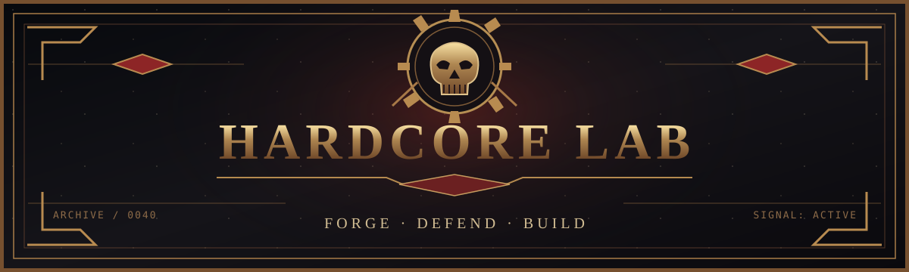

  
    
  <strong>✦ ВХОДЯЩИЙ СИГНАЛ: Adeptus Astartes ✦</strong>
    
  <em>«В мрачной тьме продакшена спасают логи, бэкапы и здравый смысл».</em>
    
  <a href="https://github.com/Hardcore-lab?tab=repositories"><b>⚔️ Исследовать архив</b></a>
  &nbsp;·&nbsp;
  <a href="https://github.com/Hardcore-lab/Hardcore-lab/issues/new"><b>📡 Отправить сигнал</b></a>

---

### ＋＋＋ Досье оператора ＋＋＋

Я — **Astartes**, здесь мой цифровой архив. Мне интересны веб-разработка, Linux, автоматизация, инфраструктура и безопасность. Люблю превращать сложные задачи в понятные работающие системы.

### ⚙️ Секторы кузни

| Сектор | Что внутри |
| :--- | :--- |
| **I · Архитектура** | Веб-проекты, интерфейсы и практичные инструменты. |
| **II · Машинный дух** | Linux, серверы, контейнеры и автоматизация. |
| **III · Оборона** | Исследование безопасности и внимательная проверка решений. |
| **IV · Эксперименты** | Новые идеи, AI-инструменты и прототипы. |

### 🕯️ Литания сборки

> Разобрать хаос. Собрать систему. Проверить дважды. Отправить в прод.

  ✠ FORGE · DEFEND · BUILD ✠ 
  Неофициальное оформление в духе мрачной научной фантастики.

